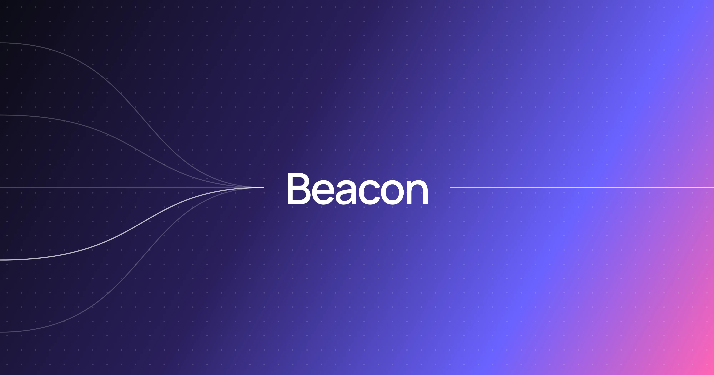

[](LICENSE)
[](https://github.com/melosso/beacon/commits/main)
[](https://github.com/melosso/beacon/releases/latest)
[](https://github.com/melosso/beacon/stargazers)

Beacon is a lightweight service for email consent and opt-out management.

- Documentation: [Github Pages](https://melosso.github.io/beacon)
- Deploy: [Install Beacon](#getting-started)
- Demo: [Visit Instance](https://beacon-demo.melosso.com/)

Store your consent and communication preferences independently of any CRM, ERP, and marketing automation tools. Beacon generates signed, expiring opt-out links, validates them, and exposes consent status through a REST API.

## What is Beacon?

Beacon serves as a **single source of truth** for consent and communication preferences, decoupling user choices from your sending tools. Permissions are grouped in **Buckets** (for example, newsletters or campaigns). Recipients manage preferences through signed, embeddable links.

#### **How it works**
- Generates cryptographically signed opt-out URLs.
- Validates permission changes without database lookups by default.
- Requires no consent logic in sending systems.

#### **Key features**

- Databases: **SQLite, SQL Server, PostgreSQL** and **MySQL**
- Admin panel for consent buckets and records
- Optional double opt-in confirmation
- Form builder for signup pages
- Granular permissions, encrypted data, hashed email addresses and rate limiting

## Getting Started

Beacon supports two deployment methods: Docker Compose and Windows Server.

### Docker Compose (Recommended)

Generate the secrets file. Docker Compose reads `.env` at startup:

```bash
# Create the .env file
if [ -f .env ]; then echo ".env already exists. Aborting."; else ADMIN_KEY=$(openssl rand -base64 48 | tr -d '\n'); ENC_KEY=$(openssl rand -base64 32); printf "SIGNING_KEY=%s\nENCRYPTION_KEY=%s\nPEPPER=%s\nADMIN_API_KEY=%s\n" "$(openssl rand -base64 32)" "$ENC_KEY" "$(openssl rand -base64 32)" "$ADMIN_KEY" > .env && echo "Your X-Api-Key is: $ADMIN_KEY"; fi
```

Create `docker-compose.yml`:

```yaml
services:
  beacon:
    image: ghcr.io/melosso/beacon:latest
    ports:
      - "5000:5000"  # Public API
      - "5001:5001"  # Admin panel
    volumes:
      - beacon_data:/app/data    # Database storage
      - beacon_core:/app/.core   # Encryption keys
    env_file: .env
    environment:
      - CONNECTION_STRING=Data Source=/app/data/Beacon.db
      - API_PORT=5000
      - ADMIN_PORT=5001

      # Host-based routing, e.g. only used when running reverse proxy
      # - API_HOSTS=beacon-api.example.com
      # - ADMIN_HOSTS=beacon-admin.example.com
      # - ALLOWED_ORIGINS=https://app.example.com
      # - TRUST_FORWARDED_HEADERS=true
      # - KNOWN_PROXIES=10.0.0.0/8

volumes:
  beacon_data:
  beacon_core:
```

```bash
# Start the container
docker compose up -d
```

The admin panel is available at **http://localhost:5001**. The API is available at **http://localhost:5000**.

### Windows (Server)

Download the latest release from [Releases](https://github.com/melosso/beacon/releases).

1. **Install .NET 11 (LTS) Runtime:**

```powershell
winget install --id Microsoft.DotNet.RunTime.11 -e
```

2. **Create `.env` with the required keys** (run in the Beacon folder):

```powershell
if (Test-Path .env) { throw ".env already exists" }
function New-Key { $b = New-Object byte[] 32; [Security.Cryptography.RandomNumberGenerator]::Create().GetBytes($b); [Convert]::ToBase64String($b) }
$adminKey = New-Key
"SIGNING_KEY=$(New-Key)", "ENCRYPTION_KEY=$(New-Key)", "PEPPER=$(New-Key)", "ADMIN_API_KEY=$adminKey" | Set-Content .env
Write-Host "Your X-Api-Key is: $adminKey"
```

3. **Install and start the service:**

```powershell
.\Beacon.bat install
.\Beacon.bat start
```

4. Open **http://localhost:5000** (API) or **http://localhost:5001** (admin panel).

Store the API key in a secure location. The API key grants access to the admin panel.

---

Please continue to the [Configuration guide](CONFIGURATION.md) for more information, as it describes host-based routing and other optimizations for production deployments.

## How to Use

The REST API stores permissions for an email address in a bucket. The API is not customizable. A token request creates the permission state and returns a signed JWT. The JWT contains the consent data. Opt-out link validation requires no database lookup by default:

```bash
https://beacon.acme-corporation.com/u/v1.eyJiIjoicTEtY2FtcGFpZ24iLCJlIjoia...
```

Opt-out links are for use in newsletters, system notifications, and other messages. Recipients manage permissions in Beacon. Consent data is stored outside the sending system's data source.

## API-first

Integrations call the API from automated workflows. The web UI supports manual operations. A token request for a bucket that does not exist creates the bucket.

#### Generate Token
Creates consent records and returns signed opt-out tokens.

```bash
curl -X POST http://localhost:5000/api/tokens/generate \
  -H "X-Api-Key: your-api-key" \
  -H "Content-Type: application/json" \
  -d '[{
    "bucket": "q1-campaign",
    "email": "user@example.com",
    "name": "Jane Doe",
    "permissions": {
      "newsletter": true,
      "marketing": false
    }
  }]'
```

The response is an array: `[{"token":"<signed_token>","doubleOptIn":false}]`. A single-item request returns one element.

If `skipPermissionUpdate` is `true`: existing permissions, including recipient updates, are not overwritten.

#### Process Opt-Out
The token link opens the preference page.

```
GET /u/{token}
```

#### Check Consent
Returns the consent status of a permission. Call before sending email.

```bash
curl -X POST http://localhost:5000/api/consent/check \
  -H "X-Api-Key: your-api-key" \
  -H "Content-Type: application/json" \
  -d '{"bucket": "q1-campaign", "email": "user@example.com", "permission": "newsletter"}'
```

#### Override Consent
Sets the consent status of a permission.

```bash
curl -X POST http://localhost:5000/api/consent/override \
  -H "X-Api-Key: your-api-key" \
  -H "Content-Type: application/json" \
  -d '{"bucket": "q1-campaign", "email": "user@example.com", "permission": "newsletter", "status": "OptedIn"}'
```

#### Delete Bucket
Deletes a bucket.

```bash
curl -X DELETE http://localhost:5000/api/admin/buckets/q1-campaign \
  -H "X-Api-Key: your-api-key"
```

#### Generate Token with Optional Features
```bash
# Supported languages: en (default), de, fr, nl, pl, es, it, pt, ja
curl -X POST http://localhost:5000/api/tokens/generate \
  -H "X-Api-Key: your-api-key" \
  -H "Content-Type: application/json" \
  -d '[{
    "bucket": "q1-campaign",
    "email": "beige@example.com",
    "name": "Beige le Brown",
    "permissions": {
      "newsletter": true,
      "marketing": false
    },
    "customFields": {
      "externalId": "external-reference"
    }
    "allowReplay": false,
    "expiryDays": 30,
    "language": "nl",
    "skipPermissionUpdate": true
  }]'
```

## Configuration

Settings are read from `.env`, `docker-compose.yml`, or `appsettings.json`. Check out the [Configuration](CONFIGURATION.md) page which contains all settings.

## License

Beacon is free for open source projects and personal use under the **EUPL 1.2** license. See [LICENSE](LICENSE).

## Contributing

Submit issues and pull requests with the provided templates.
